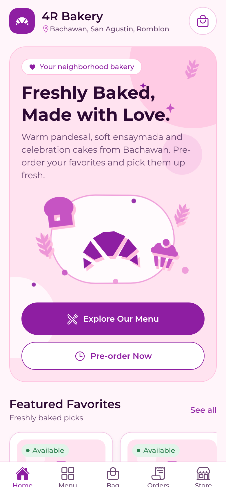
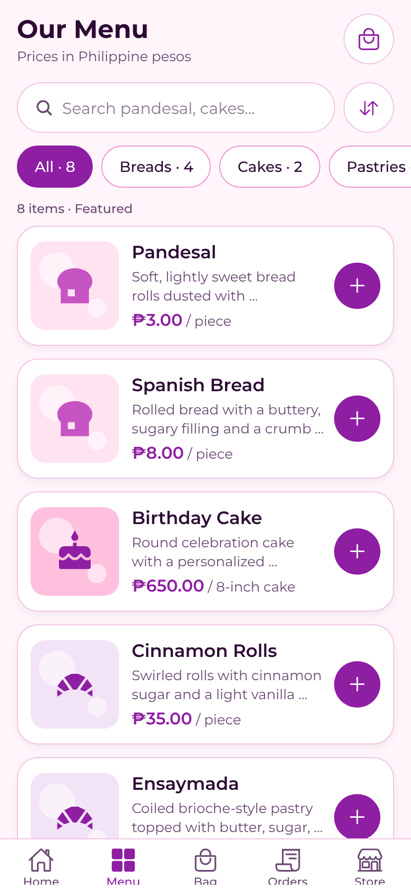
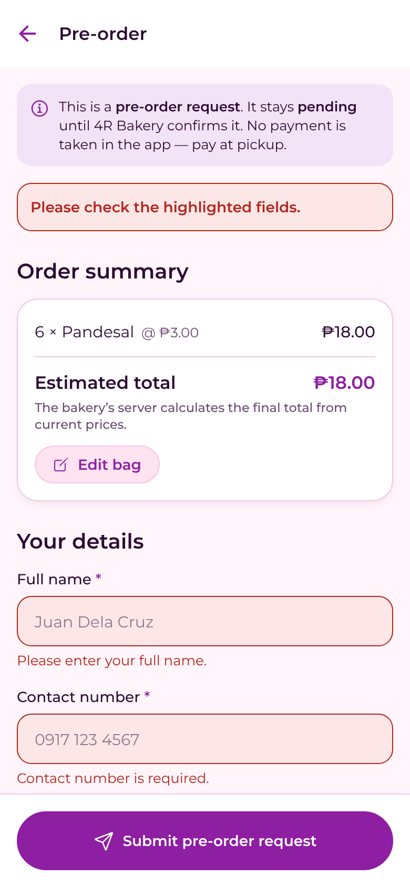
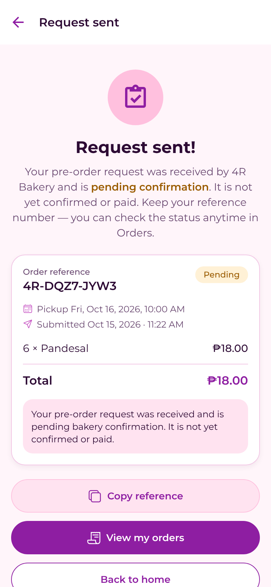
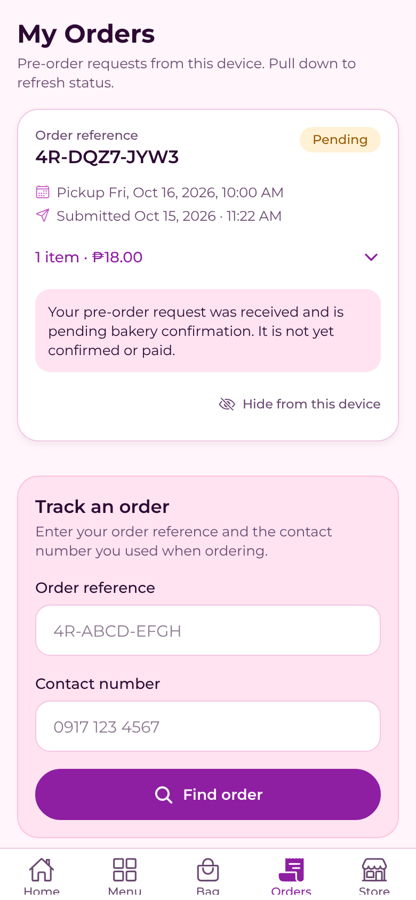

# 4R Bakery — Mobile App + API

A cross-platform customer app for **4R Bakery** (Brgy. Bachawan, San Agustin, Romblon, Philippines), backed by a Python REST API. Customers can browse the menu, fill a bag, and submit **pre-order requests**. Each request stays *pending* until the bakery confirms it. Customers can then track the status.

| Home | Menu | Pre-order | Confirmation | Orders |
|---|---|---|---|---|
|  |  |  |  |  |

*(Screenshots come from the web build, driven by Playwright against the real API. Native renders use the same components.)*

## Project structure

```text
4R-Bakery/
├── backend/                 FastAPI + SQLAlchemy + SQLite (PostgreSQL-ready)
│   ├── main.py              App, routes, middleware, error handling
│   ├── config.py            Settings from environment / .env
│   ├── database.py          Engine + session
│   ├── models.py            Product, Order, OrderItem
│   ├── schemas.py           Pydantic request/response models, validation
│   ├── crud.py              Business rules: pricing, pickup rules, inventory, lookup
│   ├── seed.py              Sample catalog (idempotent)
│   ├── manage.py            Staff CLI: list orders, change status, availability
│   ├── static/products/     Optional product photos
│   ├── tests/test_api.py    48 pytest tests
│   ├── requirements.txt / requirements-dev.txt / .env.example / README.md
└── mobile/                  Expo SDK 57 (React Native 0.86, React 19), JavaScript
    ├── App.js               Fonts, providers, navigator
    ├── app.json             Expo config (name, icons, splash, plugins)
    ├── src/
    │   ├── navigation/AppNavigator.js       Bottom tabs + stack
    │   ├── screens/  Home, Products, ProductDetails, Cart, Checkout,
    │   │             OrderConfirmation, Orders, StoreInfo
    │   ├── components/  Bakery3DCanvas, ProductCard, CategoryChip, PrimaryButton,
    │   │                LoadingState, ErrorState, EmptyState, PickupPicker, …
    │   ├── context/  CartContext (+ cartReducer), CatalogContext, OrdersContext
    │   ├── services/ api.js (HTTP client), storage.js (AsyncStorage)
    │   ├── constants/ colors.js, theme.js, config.js (API URL resolution)
    │   ├── hooks/    useReducedMotion, useDebouncedValue
    │   └── utils/    money, validation, catalog filters, dates
    ├── __tests__/   Jest: logic, API client, full-app render test
    └── e2e/         Playwright scripts for the web build
```

## Prerequisites

- **Python 3.11+** (tested with 3.13)
- **Node.js 20+** (tested with 22) and npm
- To run on devices: **Expo Go** (SDK 57) on Android or iOS, Android Studio for the emulator, or Xcode for the iOS simulator (macOS only)

## 1. Run the backend

```bash
cd backend
python3 -m venv .venv && source .venv/bin/activate   # Windows: .venv\Scripts\activate
pip install -r requirements-dev.txt
cp .env.example .env
uvicorn main:app --reload --host 0.0.0.0 --port 8000
```

Open http://localhost:8000/docs for the API documentation. The database (`backend/bakery.db`) and the sample catalog are created on first start. See [backend/README.md](backend/README.md) for configuration, endpoints and security notes.

## 2. Run the mobile app

```bash
cd mobile
npm install
npx expo start
```

Then press `a` (Android emulator), press `i` (iOS simulator), or scan the QR code with Expo Go on a phone.

### Pointing the app at the API

`localhost` on a phone means *the phone*, not your computer. `src/constants/config.js` resolves the base URL in this order:

1. **`EXPO_PUBLIC_API_BASE_URL`** in `mobile/.env` (copy `mobile/.env.example`). Recommended.
2. `expo.extra.apiBaseUrl` in `app.json`.
3. **Development auto-detect:** the IP of the machine running `expo start`, port 8000. This usually works with no configuration on emulators and phones on the same Wi-Fi.

| Where the app runs | Base URL |
|---|---|
| Android emulator | `http://10.0.2.2:8000/api` |
| iOS simulator | `http://localhost:8000/api` |
| Physical phone on the same Wi-Fi | `http://<your-computer-LAN-IP>:8000/api` (find it with `ipconfig` or `ifconfig`; allow port 8000 through your firewall) |
| Production | `https://<your-api-domain>/api`. HTTPS is required: release builds block plain HTTP on Android 9+ and iOS |

Restart `npx expo start -c` after changing `.env`. If the API can't be reached, the app shows a retry screen, and in development it also shows which URL it tried. The app **never** substitutes built-in product data.

## Features

**Home.** Shows branding, location and a bag badge. The hero has a three-layer **parallax** effect and the interactive **Bakery3DCanvas**. Below that: featured carousel, popular items, about, visit us, and a footer with working links.

**Menu.** Products come from the API with category chips, debounced search, and sorting (featured, name, price). Prices are in ₱. Unavailable items are marked and their add button is disabled. Pull to refresh; loading, empty and error states are handled.

**Product details.** Large image (or an illustrated fallback), description, category, availability, and a quantity selector. Price and availability are refreshed from the API each time the screen opens.

**Bag.** Shared state through Context and a reducer, persisted with AsyncStorage. Supports +/–, remove, clear (with confirmation), subtotals and an estimated total. There is no delivery fee because delivery isn't offered. Items that became unavailable block checkout.

**Pre-order.** Name, PH mobile number, optional email, pickup date and time (native pickers), and notes, all with inline validation. An order summary is shown, and the pending-confirmation status is stated clearly. On submit, the app:
1. Re-fetches the catalog and stops if any price or availability changed.
2. Asks for confirmation.
3. POSTs with an `Idempotency-Key`. Double taps are blocked and retries never duplicate an order.
4. Clears the bag **only after** the server returns the order.

Server field errors are mapped back onto the form fields.

**Confirmation.** Shows the real server reference, `Pending` status, server-computed totals and pickup details, with a copy-reference button.

**Orders.** Lists orders placed on this device, refreshed from the API on focus and on pull. You can also track any order by reference + contact number.

**Store.** Address with Maps and copy actions, hours, tap-to-call, email and social links. Contact details show "not yet configured" until the bakery sets them in `backend/.env`.

### Design system

The palette lives in `src/constants/colors.js`: Primary `#8E1EA2`, Secondary `#C654C3`, Accent `#ED96D7`, Soft Frosting `#FFC0DE`, Surface `#FFFFFF`, Deep Text `#2D0A34`. A few derived tints and status colors are also defined there. Spacing, radii and the type scale are in `theme.js`.

Montserrat is used throughout (Bold for titles, SemiBold for names and prices, Medium for buttons and labels, Regular for body text). If the fonts fail or take longer than 4 seconds, the app falls back to the system font with matching weights.

Touch targets are at least 44–48 dp. Icons and controls have accessibility labels.

### About the "3D" bakery visual (a substitution)

`Bakery3DCanvas` draws **layered 2.5D artwork**: croissant, bread, cupcake, wheat and sprinkles, each placed at a different depth. Perspective, rotation, floating and parallax transforms run on the native driver, and the scene tilts with the device accelerometer when one is available. React Three Fiber / expo-gl was **intentionally not used**. It would add several MB and a GL context, and tie the app to SDK-specific native code, all for a decorative element. That conflicts with the requirement not to compromise startup or compatibility.

The component:
- honors OS **Reduce Motion** by rendering a static scene,
- is `pointerEvents="none"`,
- mounts only when the JS thread is idle,
- pauses when the Home tab isn't focused,
- falls back to a flat illustration through an error boundary.

## Testing

### Executed in this environment

| Suite | Command | Result |
|---|---|---|
| Backend unit/integration | `cd backend && pytest -q` | **48 passed** |
| Mobile Jest (logic, API client, full-app render through all 5 tabs) | `cd mobile && npm test` | **19 passed** |
| Android, iOS and web bundles compile | `npx expo export --platform android` (and `ios`, `web`) | **All three bundled** (Hermes bytecode for native) |
| `npx expo-doctor` | | **19/21 passed.** The 2 failures need the Expo web API, which this sandbox's network blocks |
| Browser E2E: happy path (`mobile/e2e/happy-path.js`) | Real backend + web build + Playwright | **Passed.** Launch → info and catalog loaded from the API → search "pandesal" → open product → qty 5 → add → bag qty 6 → checkout validation errors shown → valid submit → server reference and `Pending` shown, server total ₱18.00 → Orders and Store screens |
| Browser E2E: failure paths (`mobile/e2e/failure-paths.js`) | | **Passed.** Unavailable item can't be added; sort and category filter work; submit while offline shows "Your request was not sent" and **keeps the bag**; retry succeeds with server total ₱650.00; with the API down, the menu shows a retry screen, and retry recovers |
| Persistence across backend restart | Stopped and restarted uvicorn, then fetched both orders | **Orders intact.** Wrong phone → 404. `manage.py set-status` change was visible through the API. Product count unchanged (no duplicate seeding) |
| Logging | Checked server logs for customer names and phone numbers | **None logged** |

To rerun the browser E2E:

```bash
# terminal 1
cd backend && uvicorn main:app --port 8000
# terminal 2
cd mobile && EXPO_PUBLIC_API_BASE_URL=http://localhost:8000/api npx expo export --platform web --output-dir /tmp/web \
  && python3 -m http.server 8081 -d /tmp/web
# terminal 3 (needs Playwright: npm i -g playwright && npx playwright install chromium)
cd mobile && NODE_PATH=$(npm root -g) node e2e/happy-path.js && NODE_PATH=$(npm root -g) node e2e/failure-paths.js
```

### Not yet verified: please check on real hardware

- Running the app on an **Android emulator or device and an iOS simulator or device**. Native bundles compile, but no native runtime was available here. In particular, check the native date/time pickers, accelerometer tilt, Android back-button behavior, tap-to-call and Maps links.
- Small-screen layout on a real 320 dp-wide phone (the web check used 360 and 390 px widths).
- Screen-reader walkthroughs with TalkBack and VoiceOver.

## Troubleshooting

| Symptom | Fix |
|---|---|
| "Can't reach the bakery" on a phone | Use your computer's **LAN IP**, start uvicorn with `--host 0.0.0.0`, make sure both devices share the same Wi-Fi, and allow port 8000 through the firewall |
| Works in the emulator, not on the phone | `10.0.2.2` only works inside the Android emulator; set `EXPO_PUBLIC_API_BASE_URL` |
| `.env` change ignored | Restart with `npx expo start -c` |
| Release build can't reach an `http://` API | Expected: release builds require HTTPS |
| "Pickup must be in the future" near midnight | Pickup times use bakery time (Asia/Manila) |
| Duplicate products after editing seed data | Seeding matches by `slug`. Change the slug only for genuinely new products |
| `429 Too many requests` | Raise `ORDER_RATE_LIMIT_PER_MINUTE` in development, or set it to `0` |

## Before deployment: what still needs configuring

1. **Real business details** in `backend/.env`: phone, hours, email, social links and an exact map URL. These were left blank on purpose rather than invented.
2. **The real menu and prices.** The seeded products and prices are samples. Add product photos to `backend/static/products/`.
3. **Pickup rules:** lead time, advance days, and optionally the pickup window.
4. **Hosting:** HTTPS API, PostgreSQL, proxy-level rate limiting, `ENVIRONMENT=production`. Set the production `EXPO_PUBLIC_API_BASE_URL` and build with EAS (`npx eas-cli build`).
5. **Store assets:** the app icon and splash were generated from the brand palette and a croissant glyph. Replace them with the bakery's real logo if it has one.

## Out of scope for this release (designed to be added later)

The following were deliberately **not** built:
- payments,
- delivery,
- customer accounts,
- an authenticated staff/admin interface (status changes currently use `manage.py`),
- push notifications,
- real-time stock.

The `OrderStatus` enum, the idempotent order API, per-item price snapshots and optional inventory tracking are in place so these can be added without rewriting the app.
